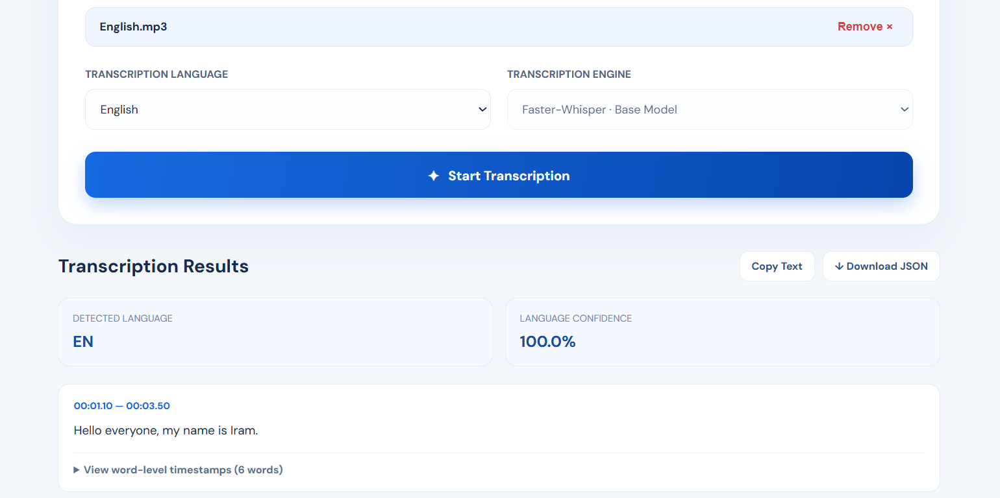
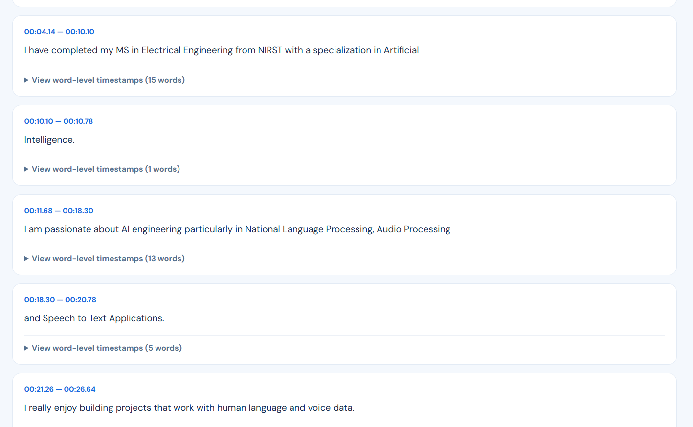
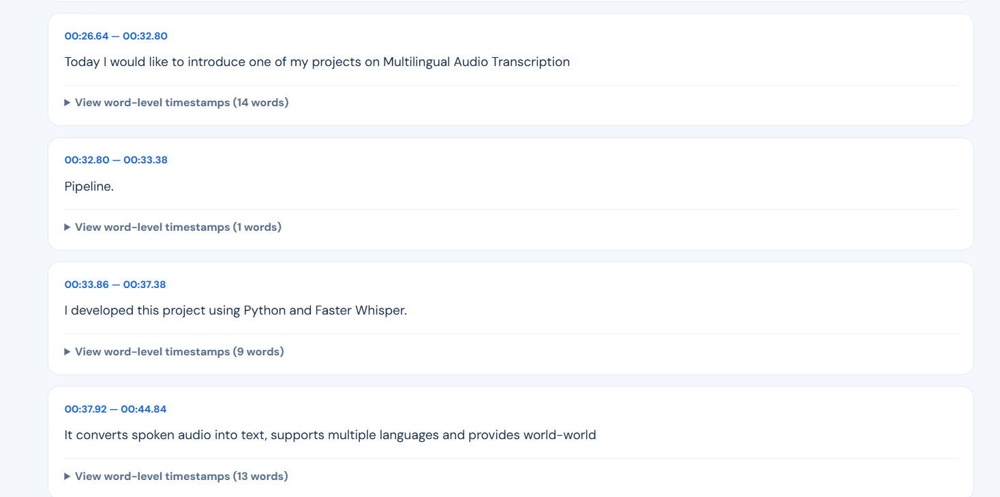
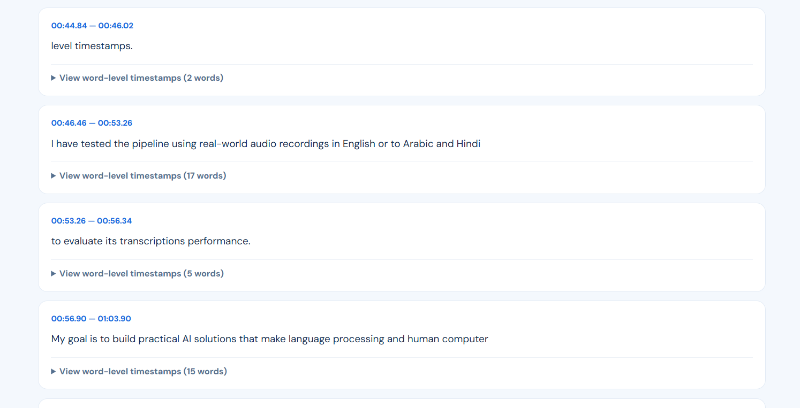
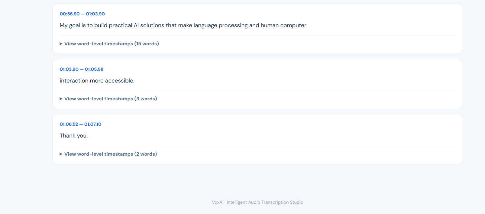
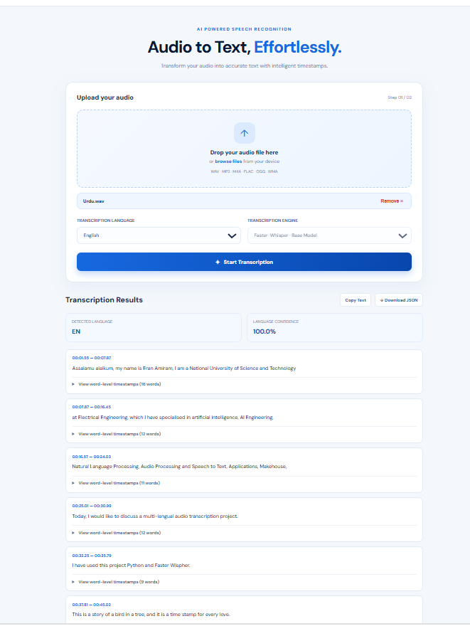
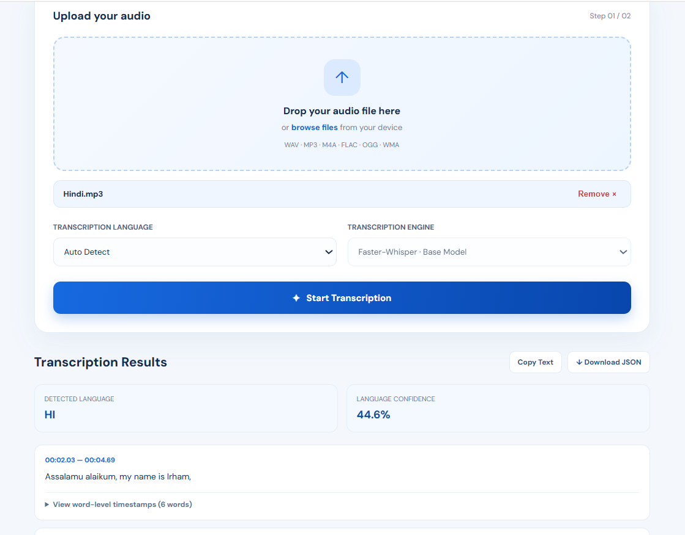
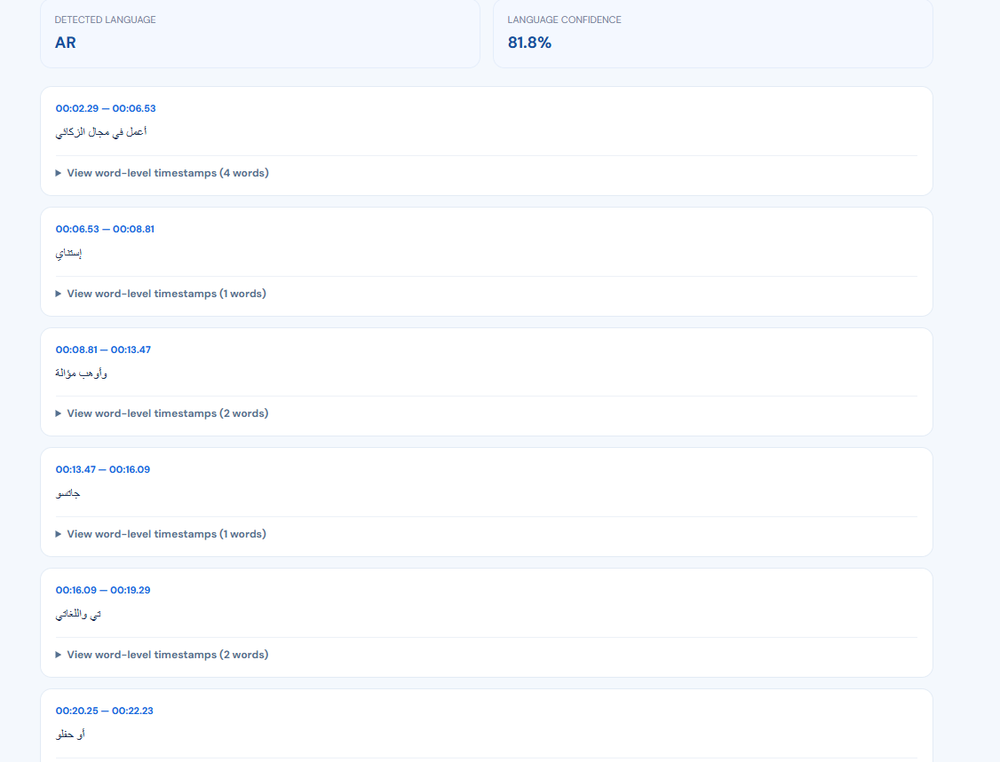

# Audio Transcription Pipeline

## Project Overview

This project builds an AI-powered audio transcription system. It turns audio into written text. The system uses the Faster-Whisper speech recognition model to do the conversion.

It offers a REST API made with FastAPI. Users can upload files and get transcription results. The results include timestamps, for each segment and each word. This makes it easy to see when each part of the speech happens.


## Key Features

- Converts audio recordings into text.
- Supports audio formats: WAV, MP3, M4A FLAC, OGG and WMA.
- Automatically detects the spoken language in audio.
- Allows selection of language.
- Gives timestamps for each segment.
- Provides timestamps for each word for audio transcription.
- Converts uploaded audio files, into WAV format if needed.
- Returns structured JSON responses.
- Cleans up temporary files after audio processing.

## Technologies Used

- Python 3.12
- Faster-Whisper
- FastAPI
- Uvicorn
- PyDub
- FFmpeg

## Project Structure

```text
audio_transcription_pipeline/
│
├── app/
│   ├── audio_utils.py
│   ├── transcriber.py
│   ├── main.py
│   └── index.html
│
├── samples/
├── outputs/
├── whisper_env/
│
├── requirements.txt
├── README.md
└── run.py
```

## Installation

### 1. Clone the Repository

```bash
git clone <repository-url>
cd audio_transcription_pipeline
```

### 2. Create a Virtual Environment

```bash
python -m venv whisper_env
```

### 3. Activate the Environment

For Windows PowerShell:

```powershell
.\whisper_env\Scripts\Activate.ps1
```

### 4. Install Dependencies

```bash
pip install -r requirements.txt
```

### 5. Install FFmpeg

Install FFmpeg and add its `bin` directory to the system PATH.

Verify the installation:

```bash
ffmpeg -version
```

## Running the Application

Start the application using:

```bash
python run.py
```

The application will be available at:

**Web Interface:** http://127.0.0.1:8000/

**API Documentation:** http://127.0.0.1:8000/docs

## API Endpoint

### POST /transcribe

Uploads an audio file and returns its transcription.

**Parameters:**

| Parameter | Type | Description |
|---|---|---|
| file | File | Audio file to transcribe |
| language | String (optional) | Language code, such as `en` or `ur` |

**Supported audio formats:**

- WAV
- MP3
- M4A
- FLAC
- OGG
- WMA

## Sample Response

```json
{
  "language": "en",
  "language_probability": 0.935,
  "segments": [
    {
      "start": 0.0,
      "end": 3.5,
      "text": "Hello, how are you?",
      "words": [
        {
          "word": "Hello,",
          "start": 0.0,
          "end": 0.8
        },
        {
          "word": "how",
          "start": 0.9,
          "end": 1.2
        },
        {
          "word": "are",
          "start": 1.3,
          "end": 1.5
        },
        {
          "word": "you?",
          "start": 1.6,
          "end": 2.0
        }
      ]
    }
  ]
}
```

*The response above is an illustrative example.*

## Model Configuration

The project uses Faster-Whisper with the Base model.

- Device: CPU
- Compute Type: INT8
- Beam Size: 5
- Voice Activity Detection: Enabled
- Word-Level Timestamps: Enabled

The model is loaded once when the application starts to avoid reloading it for every transcription request.

## Error Handling

The API includes basic error handling for:

- Unsupported audio formats.
- Audio conversion failures.
- Transcription errors.
- Temporary file cleanup.

## Future Improvements

- Support for additional languages.
- GPU-based inference.
- Speaker identification.
- Subtitle export (SRT/VTT).
- Batch audio transcription.
- Improved transcription accuracy.

## License

This project was developed for educational and technical assessment purposes.

## Project Demonstration

### Live Voice Recording Test

The system was tested using a voice recording that was created for this project. A recording that was one minute and eight seconds long in English was. It was correctly transcribed.

Other tests were also done using voice recordings in Urdu, Hindi and Arabic to check the ability to transcribe languages.

### Transcription Results

The following screenshots show the results of the transcription, including the language that was detected the time stamps for each part and the time stamps, for each word.

### English Transcription







### Urdu Transcription



### Hindi Transcription



### Arabic Transcription

